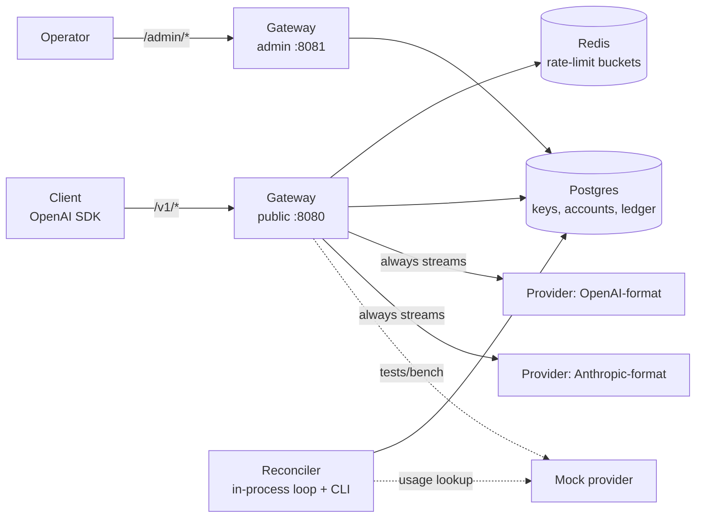
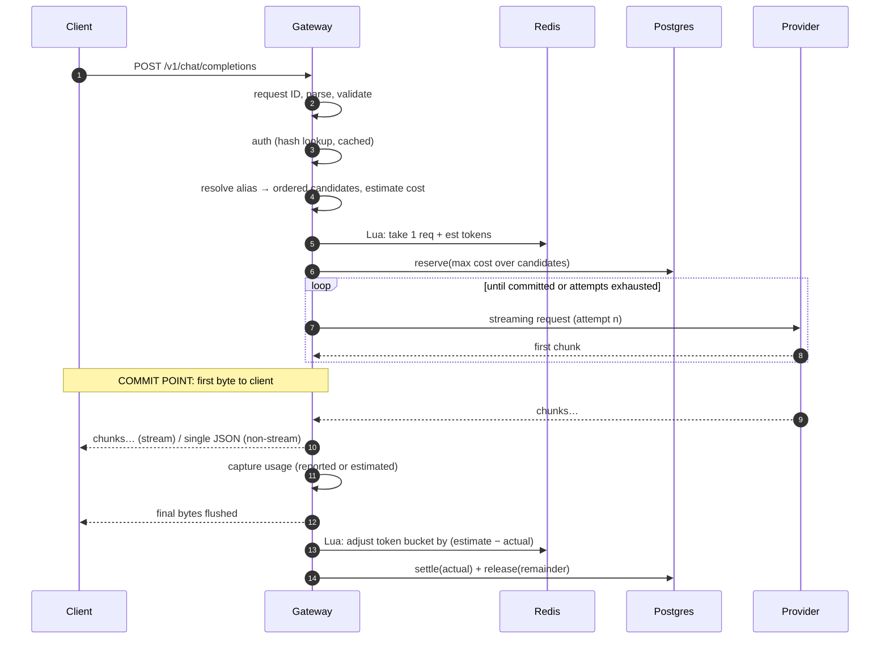
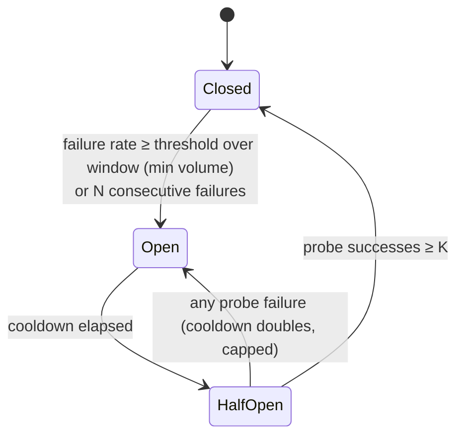

# LLM Gateway: Design

Status: Phases 0–6 are implemented (through observability); sections for later phases
describe the plan. Defaults shown for config values are starting
points, not measurements. All performance numbers will come from `scripts/` in Phase 7.

## 1. Scope

An OpenAI-compatible HTTP gateway in front of several LLM providers. It provides:

- streaming passthrough with low added latency;
- routing by price, live latency, or static priority, with circuit breakers and failover;
- per-key rate limits (requests/min, tokens/min) and spend budgets;
- an append-only usage ledger where every request is charged **at most once**, and is
  charged **exactly once** whenever its usage is knowable (§9, §12).

Out of scope: marketplace UI, real payments, provider catalog sync, user accounts beyond
API keys, multi-region deployment.

## 2. Components



| Store | Holds | Why there |
|---|---|---|
| Postgres | API key hashes, per-key accounts, ledger | Money must be transactional and durable. Reserve and settle are single ACID transactions. |
| Redis | Rate-limit token buckets | Hot path, approximate, safe to lose. Atomic Lua gives correct behavior under concurrency. |
| Gateway memory | Route table, latency EWMAs, circuit breakers, auth cache | Read on every request, so they need zero network hops (see §14, D3). |

## 3. Request lifecycle



| # | Step | Failure → client sees | Ledger effect |
|---|---|---|---|
| 1 | Assign request ID (UUIDv7, gateway-generated; a client `X-Request-ID` is logged as `client_request_id` only) | — | — |
| 2 | Parse and validate (body size limit, `n>1` rejected) | 400 | none |
| 3 | Auth: `sha256(bearer)` → `api_keys` lookup, cached in-process for `AUTH_CACHE_TTL` (default 10s) | 401 | none |
| 4 | Resolve alias → candidate targets, filtered by capability and ordered by policy (§6) | 404 `model_not_found` / 400 if no candidate supports the request | none |
| 5 | Estimate: `est_in` (§8.3), `max_out`, reservation `R` = max cost over candidates | — | — |
| 6 | Rate limit: one Lua call takes 1 request and `est_in + max_out` tokens (§7) | 429 + `Retry-After` | none |
| 7 | Reserve `R` (single SQL statement, §8.4) | 402 if budget insufficient; 503 if Postgres is unavailable (fail closed) | `reserve` |
| 8 | Attempt loop with failover, allowed **only before the commit point** (§6.4) | 502/503/504 if every attempt fails | `release(R)` |
| 9 | Stream to client, or aggregate for non-stream | after commit: SSE error event (§6.5) | — |
| 10 | Capture usage from the provider's stream, or estimate it and set `estimated=true` | — | — |
| 11 | Hand the final bytes to the client, **then** close the request in a background task with a detached context: adjust the TPM bucket by `admitted_tokens − actual_tokens`, then settle | not visible to client; retried with backoff until the request deadline, then left to the reconciler | `settle(A)` + `release(max(R−A,0))` |

Closing runs after the handler returns, not in it, which keeps Postgres off the client's
critical path entirely (§14, D16). `Server.Drain` waits for these tasks at shutdown. If
the gateway crashes before the close, the reservation stays open and the reconciler
resolves it (§9).

**Always stream upstream.** The gateway asks the provider for a stream even when the
client asked for a non-streaming response, and builds the JSON body itself. That leaves
one code path, gives a TTFT measurement on every request (used by the `fastest`
policy), and gives partial usage when a request is cut off. The cost is building
non-stream responses ourselves; Phase 7 measures what that costs.

## 4. API surface

All error bodies use the OpenAI shape: `{"error":{"message","type","code","request_id"}}`.

### Public listener (`:8080`)

| Method & path | Notes |
|---|---|
| `POST /v1/chat/completions` | OpenAI Chat Completions request, streaming (`stream: true` → SSE) or not. Accepts `max_tokens` or `max_completion_tokens`, tools, `tool_choice`, `parallel_tool_calls`, tool messages, and image parts. Usage carries a gateway extension, `estimated: true`, when a count was estimated (§5.5). Optional `X-Route-Policy: cheapest\|fastest\|priority` overrides the alias default; an unknown value is `400 invalid_route_policy`. Response headers: `X-Request-ID`, `X-Gateway-Provider`, `X-Gateway-Attempts`. |
| `GET /v1/models` | Lists aliases in OpenAI list format, with an extra `pricing` object (max input/output price per 1M tokens across candidates). |
| `GET /healthz` | Liveness: the process is up. |
| `GET /readyz` | Readiness: Postgres and Redis are reachable. |

### Admin listener (`:8081`, `Authorization: Bearer $ADMIN_TOKEN`)

| Method & path | Body / result |
|---|---|
| `POST /admin/keys` | `{name, rpm_limit?, tpm_limit?, budget_usd?}` → `{id, key}`. The plaintext key is returned **once only**. |
| `GET /admin/keys` | List: id, name, prefix, limits, budget, created/revoked. No secrets. |
| `PATCH /admin/keys/{id}` | `{rpm_limit?, tpm_limit?, budget_usd?}`. `null` means unlimited. |
| `POST /admin/keys/{id}/revoke` | Sets `revoked_at`. Takes effect within `AUTH_CACHE_TTL`. |
| `GET /admin/keys/{id}/usage?from&to` | Derived from the ledger entries, not `key_accounts`. Budget, total spent, held, and available are current; spent, request count, and tokens by alias, provider, and model cover the window (RFC 3339; `from` inclusive, `to` exclusive). Amounts come in USD and in nano-USD. |
| `GET /admin/keys/{id}/ledger?limit&before` | Raw ledger entries, newest first. `limit` defaults to 100, at most 1000. Pass the response's `next_before` as `before` for the next page. |
| `POST /admin/reconcile` | Runs one reconciler pass now and returns what it resolved (used by scripts). 409 if a pass is already running. |

The admin API is on a separate listener so that it is not exposed when only `:8080`
is published.

### Metrics listener (`METRICS_ADDR`, default `:9090`; empty disables it)

`GET /metrics` in Prometheus format, unauthenticated. It is a listener of its own because
the metrics carry per-key spend (§14, D22). Compose does not publish it.

| Metric | Labels | Notes |
|---|---|---|
| `gateway_requests_total` | `key, model, provider, status, result` | `status` stays 200 for a stream that failed after it committed, so `result` (`completed`, `upstream_error`, `client_disconnected`, `rejected`) tells those apart. 499 means the client left before any response. |
| `gateway_requests_in_flight` | | |
| `gateway_overhead_seconds` | `stream` | Histogram. Total latency minus time spent waiting on upstreams (§14, D23). |
| `gateway_ttft_seconds` | `model, provider` | Histogram, for the attempt that served the request. |
| `gateway_tokens_total` | `key, model, provider, type` | `type` is `prompt` or `completion`. |
| `gateway_cost_usd_total` | `key, model, provider` | For dashboards. The ledger is exact. |
| `gateway_failed_attempts_total` | `model` | Attempts that did not serve the request, whether or not a later one did. |
| `gateway_breaker_state` | `provider, upstream_model` | 0 closed, 1 half open, 2 open. |
| `gateway_breaker_transitions_total` | `provider, upstream_model, to` | |
| `gateway_ratelimit_rejections_total` | `code` | By key, these are 429s in `gateway_requests_total`. |
| `gateway_ratelimit_errors_total` | | Requests admitted without a limit because Redis failed. |
| `gateway_reservations_total` | `result` | `reserved`, `insufficient_budget`, `error`. |
| `gateway_reservations_open` | | Held by this process. Crash orphans are not included: only Postgres knows those. |
| `gateway_reservation_closes_total` | `result, reason` | `settled`, `released`, `already_closed`, `failed` (left to the reconciler). |
| `gateway_reconciler_passes_total` | `result` | `ok`, `skipped`, `error`. |
| `gateway_reconciler_orphans_total` | `action` | `released_unknown_usage` is an undercharge. |

Every label value is bounded by the route table, the set of keys, or a constant. A model
that does not resolve is recorded as `unknown`, because clients choose that string.
Series with known labels start at 0, so `rate` and `increase` can see their first event;
series with a `key` label cannot, so a new key's first scrape interval is invisible to
them. Metrics update when a request ends, before its close, so they do not lag behind
Postgres.

`gateway_requests_total`, `gateway_tokens_total`, and `gateway_cost_usd_total` have one
series per key and label combination. That suits a modest number of keys; thousands would
need the `key` label dropped.

Compose runs no Prometheus server. A scraper inside the Compose network reaches the
metrics at `gateway:9090`.

**Key format:** `gw_` + 32 random bytes, base64url-encoded. Only `sha256(key)` and a
short display prefix are stored. A plain SHA-256 is enough because the keys are
high-entropy random strings, not passwords, so a slow KDF would add per-request cost for
no benefit.

## 5. Provider adapters and the internal format

### 5.1 Interface

```go
// A Target is one routable (provider, upstream model) pair with its pricing.
type Target struct {
    Provider      string
    UpstreamModel string
    Price         Price // integer micro-USD per 1M tokens, input and output
    MaxOutput     int
}

type Provider interface {
    Name() string
    // Supports reports whether this provider can honor the request. A non-nil error
    // says what it cannot do; requests are never silently altered to fit.
    Supports(req *ChatRequest) error
    // Stream starts an upstream streaming call. It returns after the upstream response
    // status is known; the error is classified (see UpstreamError).
    Stream(ctx context.Context, t Target, req *ChatRequest) (Stream, error)
}

type Stream interface {
    Recv() (*Chunk, error) // io.EOF on clean end; *UpstreamError on failure; ctx.Err() if the caller cancelled
    Usage() Reported       // what the provider has reported so far
    Close() error          // idempotent; releases the upstream connection
}

// Providers can report the two counts at different times (Anthropic sends input
// tokens first and output tokens at the end), so each has its own flag.
type Reported struct {
    PromptTokens, CompletionTokens int
    HasPrompt, HasCompletion       bool
}

type UpstreamError struct {
    Provider  string
    Status    int     // upstream HTTP status, 0 for transport errors
    Kind      ErrKind // Transport, Timeout, RateLimited, Server, Config, BadRequest, Protocol
    Retryable bool    // failover to another target may help
    Msg       string
}
```

A caller cancellation is returned as `ctx.Err()`, never as an `UpstreamError`, so a
client leaving is not counted against the provider's health.

`Stream` creates no goroutines; reads are bounded by the request context. The router
applies the per-attempt TTFT and idle timeouts (§6.4) with one `time.AfterFunc` timer
per attempt, stopped when the attempt ends. Tests check for leaks with `goleak`.

### 5.2 Internal format (OpenAI-shaped)

The public API is OpenAI's, so the internal types follow it closely and Anthropic is
translated in both directions:

```go
type ChatRequest struct {
    Model             string
    Messages          []Message
    Tools             []Tool // {Name, Description, Parameters (JSON Schema), Strict}
    ToolChoice        *ToolChoice
    ParallelToolCalls *bool
    MaxTokens         *int // effective output cap; always sent upstream
    Temperature       *float64
    TopP              *float64
    Stop              []string
    Stream            bool // client mode; upstream always streams
    IncludeUsage      bool // client set stream_options.include_usage
    User              string
    Extra             map[string]json.RawMessage // unmodeled fields; forwarded to OpenAI-format targets only
}
type Message struct {
    Role       Role          // system (also accepts "developer") | user | assistant | tool
    Content    []ContentPart // text | image (https URL or base64 data URI)
    ToolCalls  []ToolCall    // assistant only
    ToolCallID string        // tool only
}
type ToolCall struct{ ID, Name, Arguments string } // Arguments is JSON text
type Chunk struct {
    Role         string
    Content      string
    ToolCalls    []ToolCallDelta // {Index, ID, Name, ArgumentsFragment}
    FinishReason string          // stop | length | tool_calls | content_filter
}
type Usage struct { // what the gateway accounts for one request
    PromptTokens, CompletionTokens int
    Estimated bool // at least one count was estimated
}
```

The public API rejects request fields whose response data the gateway would drop while
re-encoding chunks: `logprobs`, `top_logprobs`, `audio`, `modalities`, and the legacy
`functions`/`function_call`. Other unknown fields go into `Extra`.

### 5.3 OpenAI-format adapter

Nearly a passthrough. Upstream requests always set `stream: true` and
`stream_options.include_usage: true`; the usage-only final chunk is consumed by the
adapter, and the gateway sends its own usage chunk only if the client asked for one.
`Extra` is forwarded as is (known fields win on a name clash).

The output cap is sent as `max_tokens` by default, which most OpenAI-compatible
servers accept. A provider can set `max_tokens_field: max_completion_tokens` in the
route table, which newer OpenAI models require.

Chunks are parsed into `Chunk` and re-encoded. That decode/encode per chunk costs CPU;
if Phase 7 shows it matters, we switch to forwarding the raw bytes for OpenAI→OpenAI
and scanning only for `usage`.

### 5.4 Anthropic adapter (Messages API)

The adapter calls the HTTP API directly with `anthropic-version: 2026-10-21` and
`x-api-key`, not through the Go SDK. The gateway must own retries (the SDK retries 429
and 5xx itself, which would hide failures from failover and the circuit breakers),
point the adapter at any base URL (the mock), and see raw stream bytes for timing.

| OpenAI (internal) | Anthropic |
|---|---|
| `system` / `developer` messages | joined (blank line between) into top-level `system`, wherever they appear |
| consecutive same-role messages | merged (Anthropic requires roles to alternate) |
| empty text parts | dropped (Anthropic rejects empty text blocks) |
| `image_url` (base64 data URI / http(s) URL) | `image` block with `base64` / `url` source; other URLs are rejected |
| assistant `tool_calls[]` | assistant `tool_use` blocks `{id, name, input: parsed(arguments)}`; arguments must be a JSON object |
| `tool` message(s) | `tool_result` blocks `{tool_use_id, content}` in a `user` message |
| `tools[].function{name,description,parameters,strict}` | `tools[]{name, description, input_schema, strict}`; no parameters → `{"type":"object","properties":{}}` |
| `tool_choice`: `auto` / `none` / `required` / `{function:{name}}` | `{type:auto}` / `{type:none}` / `{type:any}` / `{type:tool,name}` |
| `parallel_tool_calls: false` | `disable_parallel_tool_use: true` on the tool choice |
| `max_tokens` (optional) | `max_tokens` (required → always the effective cap) |
| `stop` | `stop_sequences` |
| `user` | `metadata.user_id` |
| `temperature`, `top_p` | API version 2026-10-21 rejects them on every model. The default value (1) means the same as omitting it, so it is accepted and not sent; any other value is rejected by `Supports` |
| fields in `Extra` (e.g. `seed`, `response_format`) | rejected by `Supports` |

Forced tool choice (`required`, or a named function) is passed through as `any`/`tool`.
The newest Claude models reject that with a 400, which reaches the client as
`upstream_rejected`.

Mapping the finish reason: `end_turn`/`stop_sequence`/`pause_turn` → `stop`,
`max_tokens`/`model_context_window_exceeded` → `length`, `tool_use` → `tool_calls`,
`refusal` → `content_filter`.

Mapping stream events:

| Anthropic event | Internal `Chunk` |
|---|---|
| `message_start` | `Role=assistant`; record input usage = `input_tokens` + `cache_creation_input_tokens` + `cache_read_input_tokens`. The `output_tokens` here is provisional and ignored |
| `content_block_start` (text) | nothing, unless it carries text |
| `content_block_start` (tool_use) | `ToolCalls[{Index: k, ID, Name}]`, where k counts tool_use blocks |
| `content_block_start` (thinking, redacted_thinking, others) | nothing; their deltas are skipped too |
| `content_block_delta` `text_delta` | `Content` |
| `content_block_delta` `input_json_delta` | `ToolCalls[{Index: k, ArgumentsFragment}]` |
| `content_block_stop` of a tool_use with no input deltas | `ArgumentsFragment: "{}"`, so clients always get valid JSON |
| `message_delta` | `FinishReason`; record the final `usage.output_tokens` |
| `message_stop` | EOF |
| `ping`, unknown event types | ignored (the API may add event types) |
| `error` | `*UpstreamError` (`overloaded_error` → retryable server error) |

Thinking content is never forwarded: OpenAI's format has no place for it, and on current
models the API returns it empty by default anyway. Its tokens are still part of
`output_tokens`, so they are billed. Because OpenAI-format clients cannot send thinking
blocks back, multi-turn tool use reaches Anthropic without them. The live test
(`make test-live`) checks that the API accepts such a history.

Simplification: Anthropic cache-read and cache-write tokens are billed at the normal
input price. Real Anthropic prices them differently, so this can overcharge relative to
the provider. It is listed as a non-guarantee.

### 5.5 Usage capture

- Each count the provider reports is used as is: the final OpenAI usage chunk, or
  Anthropic's `message_start` (input) and `message_delta` (output).
- Each count the provider does not report is estimated, and the usage is marked
  `Estimated`. That happens when the provider omitted usage, the client disconnected,
  or the stream failed mid-way. For an interrupted Anthropic stream this usually means
  only the output count is estimated.
- The estimator (`internal/estimate`) counts one token per 4 bytes of UTF-8. It counts
  bytes, not characters, so multi-byte scripts are underestimated less. It adds 4
  tokens per message and 3 per request, and counts `EST_IMAGE_TOKENS` per image
  instead of the URL or base64 length. Input is estimated from the request; output from
  the content and tool arguments the gateway actually received.
- Clients see the flag as a gateway extension, `usage.estimated: true` (omitted when
  false). The ledger records it as `usage_estimated` on the settle entry.

## 6. Routing, health, and failover

### 6.1 Route table (`ROUTES_FILE`, YAML)

```yaml
providers:
  - name: mock-a
    format: openai            # adapter
    base_url: http://mock:9000/p/mock-a/v1   # up to and including /v1
    api_key_env: MOCK_A_KEY   # optional
    usage_url: http://mock:9000   # optional: per-request usage lookup, mock only (§9)
models:
  - alias: fast-chat
    policy: cheapest          # the alias's default (priority if omitted); X-Route-Policy overrides it
    default_max_output: 1024
    candidates:
      - { provider: mock-a, model: m-small, input_per_mtok: 0.15, output_per_mtok: 0.60, priority: 1, max_output: 4096 }
      - { provider: mock-b, model: m-small, input_per_mtok: 0.20, output_per_mtok: 0.80, priority: 2, max_output: 4096 }
```

Scalar config comes from env; the route table is a file whose path comes from env. Prices
are converted to integer micro-USD per 1M tokens at load time.

### 6.2 Policies

`Router.Plan` builds each request's list of targets. It first leaves out candidates
whose adapter cannot honor the request (`Provider.Supports`), so a request with a
non-default `temperature` skips Anthropic targets (D10). If no candidate is left, the
client gets `400 unsupported_request` with each target's reason, and no upstream is
called. Each remaining target gets its own copy of the request carrying its output cap,
`min(client limit or alias default, target max_output)`. The policy then orders the
targets. Breakers are not consulted here; open targets are skipped when attempts are
made (§6.4).

- **`priority`**: static `priority` from config. Ties keep file order.
- **`cheapest`**: estimated cost of *this* request, `est_in·in_price + max_out·out_price`,
  using each target's own `max_out`. Ties are broken by priority.
- **`fastest`**: uses per-target EWMAs (α = `EWMA_ALPHA`, default 0.2) of
  **TTFT** and **decode rate** (output tokens/s after the first token). All requests have
  both, because upstream always streams.
  - Streaming request: score = `ewma_ttft`.
  - Non-streaming request: score = `ewma_ttft + expected_out / ewma_tps`, where
    `expected_out` = the alias-level EWMA of completion tokens, capped at the target's
    `max_out` (or `max_out` itself before the alias has a sample). A target with a TTFT
    but no decode rate yet scores its TTFT alone, a lower bound, so a known slow first
    token still counts against it.
  - A target with no TTFT sample, or whose newest sample is older than
    `LATENCY_STALE_AFTER` (default 30s), gets the best known score, so it competes with
    the best target on priority. The first sample after a stale period replaces the old
    average instead of blending with it.
  - `ROUTE_EXPLORE_RATE` (default 0.05) of fastest-policy requests put a random non-best
    target whose breaker is closed first. This keeps the numbers of targets that are not
    winning fresh; it is the only way a lower-priority target with stale numbers is
    measured while a higher-priority one is healthy.

Every attempt that produced output gives a TTFT sample, including one that failed
later. Every completed attempt gives a decode-rate sample and an alias output sample.
Latency and breaker state are kept per target (provider + upstream model) and shared by
every alias that routes to it (§14, D15).

### 6.3 Circuit breaker (per target)



Defaults (env): the window is the last `BREAKER_WINDOW_SIZE` (20) outcomes that are also
within `BREAKER_WINDOW` (10s). The breaker trips when at least `BREAKER_FAILURE_RATE`
(50%) of them failed and there are at least `BREAKER_MIN_REQUESTS` (5), or after
`BREAKER_CONSECUTIVE_FAILURES` (5) failures in a row however far apart. The cooldown
starts at `BREAKER_COOLDOWN` (5s), doubles on each re-trip from half-open, caps at
`BREAKER_MAX_COOLDOWN` (60s), and resets after a full close. Half-open admits
`BREAKER_HALF_OPEN_PROBES` (1) attempt at a time and closes after
`BREAKER_HALF_OPEN_SUCCESSES` (2) probe successes. Every state change resets the
counters and is logged.

**Counting.** Each admitted attempt reports one result, when it ends: success (the
upstream completed), failure, or nothing (see the table). A result from an attempt
admitted before the breaker's last state change is ignored, so an attempt that started
while closed cannot count as a probe. A half-open probe holds its slot until its attempt
ends, which delays recovery when responses are long streams (§14, D13).

| Outcome | Counts as breaker failure? | Failover allowed (pre-commit)? |
|---|---|---|
| Transport error, connect/TTFT timeout | yes | yes |
| Upstream 5xx, Anthropic `overloaded_error` | yes | yes |
| Upstream 429 | yes | yes |
| Upstream 401/402/403/404 (`KindConfig`: our credentials, account, or configured model) | yes | yes |
| Upstream 400/413/422 and other 4xx (client's request is bad) | **no** | **no**: passed through to the client as 400 |
| Mid-stream error / idle timeout after first chunk | yes | **no** (post-commit) |
| Client cancel, or `REQUEST_TIMEOUT` reached | no | no: the loop stops |

404 counts as configuration, not a client error: clients name a gateway alias, and the
upstream model ID comes from the route table. An upstream 404 is therefore the gateway's
mistake, and another target may still serve the request (§14, D11).

Health state lives in each gateway process (see §14, D3).

### 6.4 Failover and the commit point

**Commit point** is the moment the first byte goes to the client:

- **Streaming:** when the first upstream chunk that carries output arrives: content, a
  tool call, or a finish reason. Role-only chunks before it (OpenAI's opening chunk,
  Anthropic's `message_start`) are held back, so an upstream that accepts the request
  but fails before producing anything is still a pre-commit failure (§14, D12). Only
  then do we write `200` + `text/event-stream`, an opening role chunk, and that chunk.
  Before then the client has received nothing, not even headers. We cannot send SSE
  keepalive comments before committing, because they would commit the `200`.
- **Non-streaming:** when the full JSON response is written. Any failure while
  aggregating counts as pre-commit, so a non-stream request can fail over even after the
  upstream produced tokens. The provider may bill for those tokens; we do not charge the
  client for them (§12).

Attempt loop (`Router.Execute`):
1. Walk the plan's targets in order. A target whose breaker refuses is skipped, and
   skipping is not an attempt.
2. Each attempt gets its own context and one timer. The timer first runs for
   `ATTEMPT_TTFT_TIMEOUT` (default 10s), from the upstream call to the first output
   chunk, then restarts with `STREAM_IDLE_TIMEOUT` (default 30s) after every chunk. When
   it fires it cancels the attempt, which surfaces as a `KindTimeout` error. The upstream
   request carries `X-Attempt: n`.
3. On a pre-commit error that allows failover (§6.3), record it in the breaker and move
   to the next target **immediately**. Switching providers needs no wait. After a full
   pass, wait a full-jitter exponential backoff (a random time up to
   `RETRY_BACKOFF_BASE`·2^(pass−1), base 100ms, capped at `RETRY_BACKOFF_MAX` 2s) and
   start again from the top, up to `MAX_ATTEMPTS` (default 3) attempts in total.
4. Stop early when the error does not allow failover (the client's bad request), when
   the request context ends (client gone or `REQUEST_TIMEOUT`), or, before any attempt
   after the first, when less than the TTFT timeout remains before the request deadline.
   A TTFT timeout at or above `REQUEST_TIMEOUT` would therefore turn failover off, so the
   gateway refuses to start that way.
5. If nothing commits, release the reservation and answer: 400 `upstream_rejected` for
   the client's bad request; 504 for timeouts; 503 `no_healthy_upstream` with
   `Retry-After` (seconds until the first breaker admits a probe) when every breaker
   refused and no attempt was made; 502 otherwise. If attempts were made and every
   breaker then opened, the last attempt's error decides (§14, D14).
   `X-Gateway-Attempts` counts the attempts made, on success and on failure.

The TTFT timeout measures the time to the first *visible* output. Anthropic thinking
blocks are not forwarded (§5.4) and do not count as output, so a target that thinks for
longer than the timeout before writing text is treated as stalled. Raise
`ATTEMPT_TTFT_TIMEOUT` for such targets.

Tradeoff: while failover is running, a streaming client sees no bytes at all. The wait is
bounded by `MAX_ATTEMPTS × ATTEMPT_TTFT_TIMEOUT` plus backoff.

### 6.5 After the commit point

No failover. On an upstream error or idle timeout mid-stream, the gateway:
1. writes one terminal event,
   `data: {"error":{"message":"…","type":"upstream_error","code":"stream_interrupted","request_id":"…"}}`,
2. **does not** send `data: [DONE]`, and closes the stream. The official OpenAI SDKs raise
   an exception on an `error` payload, and clients that only watch for `[DONE]` can tell
   the stream was truncated because it never arrives.
3. records a breaker failure, and settles input plus the output received so far
   (estimated if the provider did not report it).

## 7. Rate limiting

Each key has two token buckets in Redis: `rl:{<key_id>}:rpm` and `rl:{<key_id>}:tpm`. The
hash tag keeps both in the same Redis Cluster slot. Each bucket is a hash
`{tokens, ts_ms}`. Capacity = the per-minute limit, refill = limit/60 per second. A
`null` limit means that bucket is skipped, and a key with neither makes no Redis call.

**Admission:** one Lua script, atomic across both buckets:

```lua
-- KEYS: rpm, tpm   ARGV: rpm_limit, tpm_limit, tok_cost   (limit 0 = skip that bucket)
local t = redis.call('TIME')
local now = t[1] * 1000 + math.floor(t[2] / 1000)       -- server clock, not the gateway's
-- refill both: tokens = min(cap, tokens + (now - ts) * rate); a missing bucket is full
-- if rpm >= 1 and tpm >= tok_cost: deduct both, return {1, 0}
-- else: return {0, wait_ms}  where wait_ms = max(time for rpm to reach 1, time for tpm to reach tok_cost)
-- neither bucket is deducted on reject
```

- `tok_cost = est_in + max_out`, with the largest `max_out` among the request's targets,
  so a request is admitted against its worst case.
- **TTL:** a bucket's TTL is the time it takes to refill, so expiry only ever removes a
  full bucket and token debt is never forgiven early.
- **Adjust** (a second small script, when the request closes): add `admitted − actual`
  back to the TPM bucket, capped at capacity. If actual > admitted the bucket can go
  negative. That debt delays later requests, so TPM holds on average. A request that
  failed used nothing, so all its tokens come back.
- If the request is rejected later with 402, or Postgres is down, its tokens are refunded
  but it still counts as a request.
- 429 `rate_limit_exceeded` sets `Retry-After = ceil(wait_ms / 1000)`, minimum 1. If
  `tok_cost > tpm_limit` the request can never be admitted, so it gets 429
  `tokens_exceed_limit` with no `Retry-After`, without calling Redis.
- **Redis unavailable → fail open**, with a warning log and
  `gateway_ratelimit_errors_total`. Budgets are in Postgres, so money stays protected; only
  rate fairness is lost while Redis is down. `RATELIMIT_TIMEOUT` (default 250ms) bounds what
  an unresponsive Redis adds to a request.

## 8. Budgets and the ledger

### 8.1 Money

Integer **nano-USD** (`*_nusd`, 1e-9 USD) in `bigint`. int64 holds about 9.2e9 USD.
Prices are integer micro-USD per 1M tokens, and

```
cost_nusd(in, out, price) = ceil((in · price.in_micro_per_m + out · price.out_micro_per_m) / 1000)
```

This is integer math with rounding of at most 1 nano-USD per request. The gateway,
reconciler, and `reconcile_check` all use this one function, so comparisons are exact.
It runs in 128 bits and saturates at 1e18 nano-USD (1e9 USD, the largest budget), because
token counts come from upstreams and a bad one must not overflow an account's totals.

### 8.2 Schema

```sql
CREATE TABLE api_keys (
  id          uuid PRIMARY KEY,
  name        text NOT NULL,
  key_prefix  text NOT NULL,
  key_hash    bytea NOT NULL UNIQUE,          -- sha256(key)
  rpm_limit   integer,                        -- NULL = unlimited
  tpm_limit   integer,
  created_at  timestamptz NOT NULL DEFAULT now(),
  revoked_at  timestamptz
);

-- Materialized per-key totals. Must always equal what the ledger derives (checked by reconcile_check).
CREATE TABLE key_accounts (
  key_id      uuid PRIMARY KEY REFERENCES api_keys(id),
  budget_nusd bigint,                         -- NULL = unlimited (a spend cap, not a balance)
  spent_nusd  bigint NOT NULL DEFAULT 0,      -- Σ settle
  held_nusd   bigint NOT NULL DEFAULT 0,      -- Σ reserve of requests with no release
  updated_at  timestamptz NOT NULL DEFAULT now()
);

CREATE TYPE ledger_kind AS ENUM ('reserve', 'settle', 'release');

CREATE TABLE ledger_entries (
  id                bigserial PRIMARY KEY,
  request_id        uuid NOT NULL,
  key_id            uuid NOT NULL REFERENCES api_keys(id),
  kind              ledger_kind NOT NULL,
  amount_nusd       bigint NOT NULL CHECK (amount_nusd >= 0),
  alias             text,
  provider          text,                     -- settle
  upstream_model    text,                     -- settle
  prompt_tokens     integer,                  -- settle
  completion_tokens integer,                  -- settle
  usage_estimated   boolean,                  -- settle
  source            text NOT NULL,            -- 'gateway' | 'reconciler'
  reason            text,                     -- release: completed | interrupted | failed | rejected | cancelled | orphan_no_call | orphan_unknown_usage
  meta              jsonb,                    -- reserve: candidate targets + price snapshot
  created_at        timestamptz NOT NULL DEFAULT now(),
  UNIQUE (request_id, kind)                   -- the idempotency key
);
CREATE INDEX ON ledger_entries (key_id, created_at);
CREATE INDEX ON ledger_entries (created_at) WHERE kind = 'reserve';
-- Append-only: triggers raise on UPDATE, DELETE, and TRUNCATE (§14, D21).
```

### 8.3 Estimating the reservation

- `est_in = ceil(estimate(messages, tools) · EST_SAFETY_FACTOR)` (default 1.25), using
  the heuristic in §5.5, where each image part counts as `EST_IMAGE_TOKENS` instead of its
  base64 length. The margin applies only here: usage estimates (§5.5) are not inflated by
  it, because it exists to avoid under-reserving, not to raise what is charged.
- `max_out = min(client max_tokens or alias default_max_output, target max_output)`.
- `R = max over the request's targets of cost_nusd(est_in, max_out, price)`. Reserving
  the maximum means failover to a more expensive target never needs a second reservation.
  The cost is holding more budget than needed while the request runs. Targets `Plan` left
  out (§6.2) do not count.

### 8.4 Reserve → settle → release

Every request that passes rate limiting writes a `reserve` entry, **including keys with
no budget**, because orphaned requests can only be found through open reservations.

**Reserve** is one statement and one round trip:

```sql
WITH acct AS (
  UPDATE key_accounts
     SET held_nusd = held_nusd + $R, updated_at = now()
   WHERE key_id = $key
     AND (budget_nusd IS NULL OR spent_nusd + held_nusd + $R <= budget_nusd)
  RETURNING key_id
)
INSERT INTO ledger_entries (request_id, key_id, kind, amount_nusd, alias, meta, source)
SELECT $req, key_id, 'reserve', $R, $alias, $meta, 'gateway' FROM acct;
-- 0 rows inserted → 402
```

The `UPDATE` takes the row lock. Under READ COMMITTED, Postgres re-checks the `WHERE`
against the latest row version after waiting for the lock. Concurrent reservations
therefore serialize per key, and the sum of reservations can never pass the budget.
The cost: requests for the same key queue on one row lock for the length of a short
transaction. Throughput for a single hot key is limited by that, and Phase 7 measures it.

**Settle** (gateway or reconciler) is also one statement, using data-modifying CTEs:

```sql
WITH r AS (
  SELECT key_id, amount_nusd, alias FROM ledger_entries WHERE request_id = $req AND kind = 'reserve'
), closed AS (
  -- Close token. Every closing path inserts a release; UNIQUE(request_id, kind) lets only one win.
  INSERT INTO ledger_entries (request_id, key_id, kind, amount_nusd, alias, reason, source)
  SELECT $req, key_id, 'release', GREATEST(amount_nusd - $A, 0), alias, $reason, $src FROM r
  ON CONFLICT (request_id, kind) DO NOTHING
  RETURNING key_id                             -- no row: already closed, nothing below writes
), charged AS (
  INSERT INTO ledger_entries (request_id, key_id, kind, amount_nusd, alias, provider, upstream_model,
                              prompt_tokens, completion_tokens, usage_estimated, source)
  SELECT $req, r.key_id, 'settle', $A, r.alias, ... FROM r JOIN closed USING (key_id)
)
-- Materialized totals (R read from the reserve row, never trusted from memory).
UPDATE key_accounts a
   SET held_nusd = a.held_nusd - r.amount_nusd, spent_nusd = a.spent_nusd + $A, updated_at = now()
  FROM r JOIN closed USING (key_id)
 WHERE a.key_id = r.key_id;
```

**Release-only** (call failed, rejected, or never happened): the same close token with
amount `R`, and `held -= R`. No `settle` row.

**Reasons** on the release entry: `completed` and `interrupted` (settled, the latter for
partial output); `failed`, `rejected` (the upstream refused the client's request), and
`cancelled` (the client left before the commit point) are released with no charge. The
reconciler adds `orphan_no_call` and `orphan_unknown_usage`.

Properties:
- **Exactly one close per request.** Every closing path inserts `release`, and
  `UNIQUE(request_id, kind)` lets only one succeed. A repeated settle, a gateway settle
  racing the reconciler, or settle racing release: the loser is a no-op.
- **Derived balances:** `spent = Σ settle`, `held = Σ reserve where no release exists`,
  `available = budget − spent − held`. `key_accounts` is a cache of these, updated in the
  same transaction and verified by `reconcile_check`.
- **Overage:** if the actual cost `A > R` (the input estimate was too low, or a provider
  ignored the max-tokens limit), we still settle the full `A`. The release amount is 0,
  and the balance may go below the budget. The next reservation then fails with 402.
  Overspend is bounded by the estimation error of requests that were in flight together.

## 9. Reconciler

The reconciler runs as an in-process loop (`RECONCILE_INTERVAL`, default 30s; 0 runs it
only on demand). It is guarded by `pg_try_advisory_lock`, so only one runs at a time
across gateway instances. It is also available as `POST /admin/reconcile` and as a
one-shot CLI for when the gateway is down (`make reconcile`).

```sql
SELECT r.id, r.created_at, r.request_id, r.meta FROM ledger_entries r
 WHERE r.kind = 'reserve' AND r.created_at < now() - $T
   AND (r.created_at, r.id) > ($last_at, $last_id)
   AND NOT EXISTS (SELECT 1 FROM ledger_entries x WHERE x.request_id = r.request_id AND x.kind = 'release')
 ORDER BY r.created_at, r.id LIMIT 100;
```

`T = REQUEST_TIMEOUT + RECONCILE_GRACE` (default 30s, at least `LEDGER_TIMEOUT`, since the
gateway's own close may run that long past the deadline). The gateway enforces
`REQUEST_TIMEOUT` as a hard deadline on every request, so a reservation older than `T`
cannot belong to a live request. Postgres `now()` is the only clock involved. If the
timeout assumption were ever violated, the close token would still prevent a double
charge. A pass pages through all orphans by key, so one it cannot resolve does not hide
the ones behind it. Each pass reads every old reserve entry, so its cost grows with the
ledger; a watermark would bound it if that ever matters.

For each orphan, it looks up every target on the reserve entry that has a `usage_url`:

| Lookup result | Action |
|---|---|
| A billable record | `settle` the **last** billable attempt, using its provider, model, and tokens, priced with the snapshot in the reserve's `meta`; `source='reconciler'`, reason `completed` or `interrupted` by the record's outcome (§14, D20) |
| No billable record, and every target could be asked (call never happened, or failed before the first token) | `release(R)`, reason `orphan_no_call` |
| No billable record, and some target has no `usage_url` (real providers have no per-request usage API) | `release(R)`, reason `orphan_unknown_usage`; metric + log. No record then does not show that no call happened. **This is an undercharge, by design** |
| Lookup error (e.g. mock unreachable), or a billed model missing from the snapshot | skip; retry on the next pass rather than guess |

`orphan_no_call` trusts a missing record, so a usage source must be complete: the mock
reloads its usage file at startup for this reason (§11).

**Audit.** `scripts/reconcile_check` (`make reconcile-check`) recomputes what the ledger
claims from its entries, without writing anything, and exits 1 if a check fails. Run it
with traffic stopped:

| Check | Fails when |
|---|---|
| `account_totals` | `key_accounts` differs from what the entries derive |
| `structure` | a close or charge has no reserve, or a charge has no close |
| `close_amount` | a release does not equal `max(R − A, 0)`, or `R` with no charge |
| `cost` | a charge differs from its tokens at the reservation's price snapshot |
| `provider_usage` (with `-mock-url`) | a charge differs from the provider's record of the attempt that served it. Estimated charges are counted, not compared |
| `open` (with `-require-closed`) | a reservation is still open |

It reports gateway and reconciler charges separately, because the reconciler charges from
the provider's records and so agrees with them by construction.

**Change from what I proposed earlier:** I had suggested a separate `usage_captured`
entry written before settling. Because settle runs right after usage is captured, that
entry would be a second write with the same crash window, so it adds nothing. It would
only help if we checkpointed usage *during* long streams. That is a possible later
addition, not part of v1.

## 10. Failure semantics

"Received output" means output tokens the gateway actually read from upstream.

| Situation | Upstream | Client sees | Charged |
|---|---|---|---|
| Bad auth / unknown model / invalid body | not called | 401 / 404 / 400 | nothing, no ledger rows |
| Rate limited | not called | 429 + `Retry-After` | nothing, no ledger rows |
| Budget insufficient | not called | 402 | nothing, no ledger rows |
| Postgres down at reserve | not called | 503 | nothing (fail closed) |
| Redis down | called | normal | normal (rate limits fail open) |
| Provider 400-class (bad request) | called once | 400 passthrough | release R, 0 |
| All attempts fail pre-commit | called ≤ `MAX_ATTEMPTS` | 502 / 503 / 504 | release R, 0 |
| Failover then success | several | normal response | only the attempt that succeeded |
| Client disconnects pre-commit | cancelled via ctx | — | release R, 0 |
| Client disconnects mid-stream | cancelled via ctx | — | input + received output, `estimated` unless usage was reported |
| Upstream error mid-stream | — | SSE error event, no `[DONE]` | input + received output, usually `estimated` |
| Non-stream upstream fails mid-generation | fail over | normal response from next attempt | only the successful attempt |
| `REQUEST_TIMEOUT` hit | cancelled | as pre- or post-commit error | as the rows above |
| Postgres down at settle | completed | normal response | settle retried until the deadline, then the reconciler handles it |
| Gateway crash before upstream call | not called | connection drop | reconciler: release R |
| Gateway crash mid-stream or before settle | partial / complete | connection drop or full response | reconciler: mock → recorded usage; real → release (undercharge) |
| Actual cost > reservation | — | normal | full actual cost; balance may go below budget |
| Graceful shutdown (SIGTERM) | in-flight allowed to finish within `SHUTDOWN_DRAIN_TIMEOUT`, then cancelled | finished, or SSE error event | as completed or as mid-stream error |

Client disconnect is detected through `r.Context()`, which is cancelled when the
connection closes. The upstream request uses that context, so it is cancelled too.
Settlement then runs under `context.WithoutCancel(ctx)` with its own timeout, so the
cancellation that ended the request does not also abort its accounting.

## 11. Mock provider

A separate service (`cmd/mockprovider`), speaking OpenAI format (Anthropic format is
added in Phase 2 for adapter tests).

- **Multiple virtual providers on one service:** `/p/{name}/v1/chat/completions`. Each
  name has its own behavior, so failover tests run against one container.
- **Behavior:** `ttft_ms`, `tokens_per_sec`, `output_tokens`, `error_rate` +
  `error_status`, `fail_after_tokens` (mid-stream failure), `hang` (accept, never
  respond). Set through env defaults, `PUT /_mock/providers/{name}` at runtime, and
  per-request `X-Mock-*` headers.
- **Deterministic:** seeded RNG per (provider, request ID). The output text is a function
  of the seed. Prompt tokens are counted with a rule that differs on purpose from the
  gateway's estimator (word-based), so tests can tell reported usage from estimated.
- **Records usage:** keyed by the gateway's `X-Request-ID` and `X-Attempt` headers. Each
  record holds `{provider, model, prompt_tokens, completion_tokens, billable, outcome}`.
  An attempt is **billable iff it completed or flushed at least one content token**. A
  completed response reports usage, so the gateway charges its input even with zero
  output. Its completion tokens are the tokens flushed. A completed attempt is
  recorded *before* its final bytes (`[DONE]` / the JSON body) are written, so a caller
  that has read the whole response can always find the record. Queried with
  `GET /_mock/usage?request_id=` and exported with `GET /_mock/usage`.
- Records are kept in memory and optionally appended to JSONL (`MOCK_USAGE_FILE`), which
  is reloaded at startup, so they survive a mock restart.

## 12. Guarantees and non-guarantees

**Guaranteed**
- No request is ever charged twice (`UNIQUE(request_id, kind)` close token).
- Concurrent requests on one key cannot reserve more than its budget (row-locked
  conditional update).
- No failover after the first byte reaches the client. The client never receives output
  from two providers in one response.
- Every reservation is eventually closed by the gateway or the reconciler. No reservation
  stays open longer than `T` + one reconciler interval while Postgres and its targets'
  usage sources are up.
- Against the mock, the settled cost per request equals the mock's recorded usage, except
  for requests marked `estimated`.

**Not guaranteed**
- Charges for disconnected or interrupted streams are estimates (flagged). The provider
  may have generated tokens that were still in flight and never reached us.
- With real providers, requests orphaned by a crash are released, which **undercharges**
  the client.
- With the mock, a request orphaned while a non-streaming attempt was collecting is
  charged for that attempt's tokens, though the client received nothing. The usage record
  cannot show what reached the client.
- Attempts abandoned during failover may be billed by the provider but are not charged to
  the client. That cost falls on the gateway operator.
- Spend can exceed the budget by the estimation error of in-flight requests.
- A client close to its budget can get a 402 for a request that would have fit: the
  previous request's whole reservation is held until its background close finishes, which
  may be just after the client has its response.
- Rate limits are not enforced while Redis is down.
- Revocation takes effect within `AUTH_CACHE_TTL`, not immediately.
- Anthropic cache tokens are priced as normal input tokens.
- Estimated counts come from a 4-bytes-per-token heuristic, not the provider's tokenizer.
  How far off it is depends on the text. It is not measured here, because the mock's
  tokenizer is synthetic.
- Thinking content from Anthropic models is not forwarded, and OpenAI-format clients
  cannot send thinking blocks back in later turns.
- There is no client idempotency: a client retry is a new request and a new charge.

**What the Phase 7 ledger chaos test can and can't show:** requests resolved by the
reconciler are compared with the mock's records, and they were settled *from* those
records, so they agree by construction. The test is meaningful for (a) requests settled
by the gateway, compared against the mock, (b) no request being closed twice, and
(c) no reservation left open after the drain. The report will show these separately.

## 13. Repository layout (preview of Phase 1)

```
cmd/gateway/          main: public + admin listeners, reconciler loop
cmd/mockprovider/     mock provider service
cmd/reconcile/        one-shot reconciler CLI, for when the gateway is down
internal/config/      env + routes file
internal/httpapi/     handlers, OpenAI wire types, SSE writer, error mapping
internal/auth/        key hashing, lookup, cache
internal/provider/    interface + internal types; openai/, anthropic/ adapters
internal/router/      policies, EWMA, breaker, attempt loop
internal/ratelimit/   Redis Lua buckets
internal/ledger/      reserve/settle/release, reconciler, pricing math
internal/estimate/    TokenEstimator
internal/mock/        mock provider implementation
internal/obs/         slog setup, request-ID middleware, metrics
migrations/           SQL migrations
scripts/              loadtest/, failover_test/, ledger_chaos/, reconcile_check/
bench/results/        committed benchmark output
```

## 14. Decisions to confirm in review

| # | Decision | Differs from the plan? | Reason |
|---|---|---|---|
| D1 | Budgets and reservations live in **Postgres** (row-locked conditional update), not Redis | Yes: the plan put budgets in Redis | With one transactional store there is no window where Redis and Postgres disagree. The cost is a per-key row lock. |
| D2 | Resolve candidates **before** reserving, and reserve the max cost across them | Order changed: the plan had reserve → route | The reservation depends on candidate prices, and failover must never need a second reservation. |
| D3 | Latency and breaker state live **in-process**, not in Redis | Yes: the plan put health state in Redis | They are read and written on every request, and Compose runs one gateway. Sharing them across instances is a later addition if we scale out. |
| D4 | **Always stream upstream**, and build non-stream responses in the gateway | New | One code path, TTFT on every request, partial usage on interruption. |
| D5 | After an error event mid-stream, **omit `[DONE]`** | Changes what I said earlier | A missing `[DONE]` is the truncation signal for simple clients. |
| D6 | Dropped the separate `usage_captured` entry | Changes recommendation 2 | It has the same crash window as settle (§9). |
| D7 | Settle **after** the last byte is flushed | New | Keeps a Postgres round trip off client latency; the crash window is covered by the reconciler. |
| D8 | Money in integer nano-USD; prices in micro-USD per 1M tokens | New | Exact integer comparisons in `reconcile_check`. |

Decided during Phase 2:

| # | Decision | Reason |
|---|---|---|
| D9 | The Anthropic adapter calls the HTTP API directly, not through the Go SDK | The SDK's built-in retries would hide 429/5xx from failover and the breakers. The gateway also needs any base URL (the mock) and raw stream timing. Cost: we maintain the wire types ourselves; the mock enforces the 2026-10-21 rules to catch drift. |
| D10 | Anthropic targets reject non-default `temperature`/`top_p` and unmodeled fields instead of dropping them | API version 2026-10-21 rejects sampling parameters on every model. Silently dropping a client's `temperature: 0.2` would change its output without telling it. Cost: such requests can only use OpenAI-format targets. Since Phase 3, `Plan` leaves Anthropic targets out for them, so they route to an OpenAI-format target when the alias has one, and get 400 when it does not. |
| D11 | Upstream 401/402/403/404 are configuration errors that allow failover | The client never names the upstream model, so these are the gateway's credentials, account, or route table, not the client's request. |
| D12 | The streaming commit point is the first chunk with output, not the first chunk | An upstream that sends `message_start` and then fails can still be failed over. |

Decided during Phase 3:

| # | Decision | Reason |
|---|---|---|
| D13 | A breaker counts each attempt once, when it ends; a half-open probe holds its slot until then | Counting success at the commit point and failure at a later mid-stream error would count one request twice and dilute the failure rate. Cost: recovery takes at least the cooldown plus two full responses (1 probe at a time, 2 successes). For targets that serve long streams, raise `BREAKER_HALF_OPEN_PROBES`. |
| D14 | `503 no_healthy_upstream` only when every breaker refused before any attempt | If the request's own attempts opened the breakers, the last upstream error (502/504) says more about what happened than a 503 the gateway produced itself. |
| D15 | Health is per target (provider + upstream model), shared by every alias that uses it | One model's 404 or overload should not block the provider's other models, and aliases that share a target share its evidence. Cost: a provider-wide outage trips each of its models' breakers separately. |

Decided during Phase 4:

| # | Decision | Reason |
|---|---|---|
| D16 | Requests are closed in a tracked background task, not in the handler | A running handler holds the response open: a stream's terminating chunk, and the next request on a keep-alive connection, would wait for Postgres for as long as settlement retried. Refines D7. Cost: a task to drain at shutdown, and one possible spurious 402 near the budget (§12). |
| D17 | Reserve, settle, and release are each one SQL statement | Atomic with one round trip, where §8.4 first described a three-statement transaction. Behaviour is unchanged. |
| D18 | Idempotent settle and its retries were built in Phase 4, not Phase 5 | Budgets cannot work without closing requests, and a non-idempotent close would only have been replaced. Phase 5 keeps the reconciler, usage reads, and `reconcile_check`. |

Decided during Phase 5:

| # | Decision | Reason |
|---|---|---|
| D19 | A provider opts in to usage lookups with `usage_url` in the route table | The reconciler must tell "this provider says no call happened" from "we cannot ask". One field per provider keeps that decision in the route table, and a request whose targets mix both kinds is treated as unknown. |
| D20 | The reconciler charges the last billable attempt | The last attempt is the one that was serving the client when the gateway stopped; earlier attempts failed over, and those are not charged (§10). |
| D21 | Append-only is enforced by triggers only, not also by grants | §8.2 first said the app role would have no UPDATE/DELETE grant, but the gateway connects as the database owner, which also runs migrations. A separate least-privilege role needs a second database URL. Cost: anyone with owner access can disable the triggers. Worth adding in a real deployment. |

Decided during Phase 6:

| # | Decision | Reason |
|---|---|---|
| D22 | `/metrics` has its own listener, not the public port as §4 first said | The metrics carry per-key spend, which anyone reaching `:8080` could otherwise read. The admin listener would need the token in Prometheus's config, and it is off when `ADMIN_TOKEN` is unset. |
| D23 | Overhead subtracts time actually spent waiting on upstreams, added up per call | A stream interleaves waiting with the gateway's own encoding and writing, so subtracting one start-to-end span would hide per-chunk cost. Backoff counts as waiting. Time blocked on a slow client counts as overhead. |
| D24 | Requests carry a `result` label beyond the plan's key, model, provider, and status | `status` is 200 for a stream that failed after it committed, so status alone would hide those failures. |
